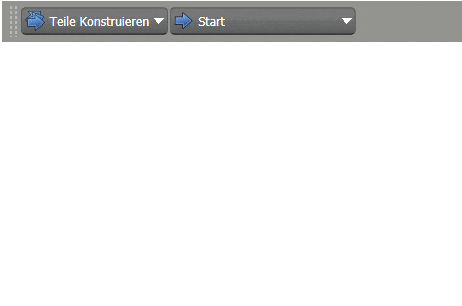
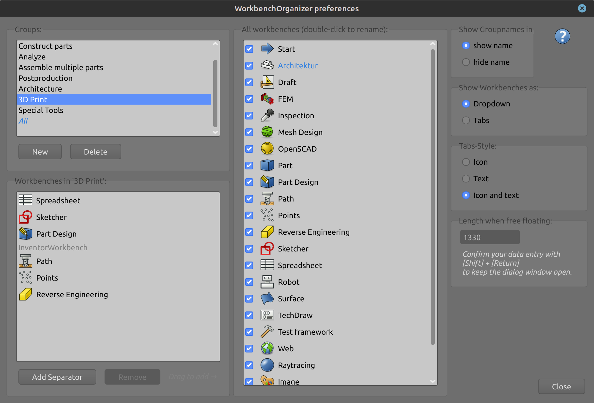
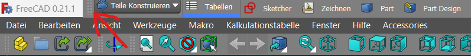
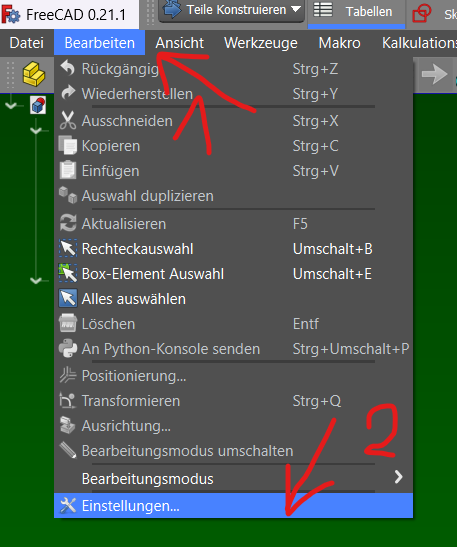
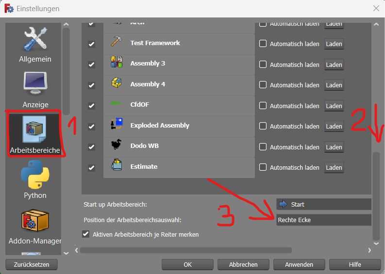

# WorkbenchOrganizer
A workbench organizer widget for FreeCAD.

The aim of the workbench organizer (WBO) is to organize the long list of workbenches into meaningful groups.

The WBO provides **workbench groups** with an **additional selector** to first select a group of workbenches which then allows to select a workbench from a (reduced) group of workbenches with the aim of making it easier to find your workbenches.

It also allows to present the workbenches in tabs or in a dropdown list.

It allows to put **one workbench in multiple groups**. So i.e. the Spreadsheet-Workbench might appear in multiple groups.

It even allows you to put workbenches **into the group-selector dropdown**. This might be useful for workbenches like Spreadsheet that you might want to put in many groups maybe to save space in your TabBar.

WBO further allows to **rename workbenches** whether to translate or to give it a - for you - more meaningful name. *Who remembers that a workbench like 'Dodo' is meant for constructing pipelines and frameworks after a year not using FreeCAD? In the videos you can see, that we have renamed several workbenches in German language. Like 'Spreadsheet' --> 'Tabellen'*

Of course, you also find an 'All'-workbenches group to access workbenches the traditional way.

## Installation
As long as the WBO is not available in the AddOn-Manager, you need to install it manually.
1. Download the code from here to any place on your computer.
2. Extract the zip file, if you have downloaded it as a zip file.
3. RENAME the folder from "WB_Organizer_main" to "WB_Organizer". (I don't know why GitHub adds this "_main".
4. move or copy the extracted folder inside your FreeCAD Mod folder, so that you get i.e.
Linux:   `/home/user/.FreeCAD/Mod/WB_Organizer/InitGui.py`
macOS:   `/Users/user_name/Library/Preferences/FreeCAD/Mod/WB_Organizer/InitGui.py`
Windows: `C:\Users\user_name\AppData\Roaming\FreeCAD\Mod\WB_Organizer\InitGui.py`
On the next startup, FreeCAD will find your new AddOn.

The WBO runs with FreeCAD 0.20 and newer, with Qt5 as well as with Qt6 (FreeCAD 1.x).

## Preferences dialog
The preferences dialog can be accessed from within the groups dropdown or under __menu -> Accessories -> WorkbenchOrganizer__.

It has three columns:

**Groups and their workbenches (left)**
* **Select** a group to see its workbenches below.
* **New** creates a group, **Delete** (or [Del]) deletes the selected group.
* **Double-click** a group to rename it.
* **Drag** a group up or down to change the order of the groups dropdown.
* **Drag workbenches** from the list of all workbenches (middle) into the group. You can drag several at once.
* **Drag** workbenches inside the group to sort them.
* **Remove** (or [Del]) removes the selected workbenches from the group (they stay installed, of course).
* **Add Separator** inserts a separator line below the selected workbench.
* **In groups dropdown** at the top of the list holds the workbenches that appear directly inside the groups dropdown, above the groups. This might be useful for workbenches like Spreadsheet that you want to have at hand everywhere. Fill it like a group.

**All workbenches (middle)**
* **Drag** workbenches to sort them. This is the order of the 'All' group.
* **Uncheck** a workbench to hide it everywhere in the WBO.
* **Double-click** a workbench to rename it (see below).

**Options (right)**
* Show the name of the selected group in the groups button, or just the icon.
* Show the workbenches as tabs or as a dropdown, and the style of the tabs.
* The length of the WBO when it is free floating (you can also drag it, see the tips below).
* The **?** button opens the online help (the wiki).

All changes are saved and shown immediately.

**I especially like to kudos to TRIPLUS who has provided several very exciting tools like the 'Glass' AddOn, the 'PieMenu' AddOn, and the 'TabBar' Addon which this WBO is based on.** *The 'TabBar' AddOn has been kind of abandoned since 2017 or so. So I hijacked it and took it as a starting point for the development of WBO which saved me a lot of time.*

## Tips on how to use the Workbench Organizer right now
The WBO is a workbench by itself and thus would live inside the workbenches at the top of your window.
The problem with this is, that workbenches are somehow reordered on each change of a workbench. This leads to your WBO jumping around.

We haven't figured out yet how to fix the WBO in the very first line of the workbenches and how to reserve the full first line for it.
So your WBO might all of a sudden collapse to a short widget forcing you to rearrange your workbenches again and again.

That's NOT, what you want.

### BUT ... there's a workaround for the moment!
UNDOCK your WBO from the toolbar and make it free-floating! You could attach it to the top, the bottom or even to the sides of your main window. But that's NOT what you go for! 
Move your WBO right at the very top into the header line of FreeCAD, right aside from the FreeCAD-LOGO at the top left of your window. So your WBO will sit above your menu.
Like so:

To adapt the length of your free floating WBO to your screen size, **drag the small handle at its right end**. The WBO keeps this length, also after a restart.
Alternatively, you can enter the **'Length when free floating'** in the 'preferences' dialog of the WBO on the right side.
Confirm your changes with [Shift] + [Return] so as not to leave the whole dialog on [Return] and see an immediate result! 

As we can't hide the standard workbench selector we want to put it a little bit 'out of our sight' to the top right.
Go to the configuration panel (menu -> edit -> configurations (or so?))

1. Select the Workbench dialog (the 3rd from the top), ...
2. scroll down to the very bottom of the list, and ...
3. select inside the dropdown to place the selector widget in the **top right corner** of the window.

Now after a restart, your old Workbench selector will sit in the top right corner like so:

There it is still available but won't disturb or confuse you.

Finally, you might consider removing some useless buttons from the workbenches area like the file load and save buttons, and the undo and redo buttons to save you some more screenspace. *(Won't you use [Ctrl]+[Z] for undo and [Ctrl]+[Y] for redo? So why waste your screen space with these buttons?)*

Now you can try to **rearrange all your workbench buttons** in a way that they are not shuffled around on each workbench change. See how the upper left part of our workbenches remains static on the change of workbenches.

We hope WBO helps you to get things done faster and with more pleasure and fun as you do not need to scroll so much on the search for your workbenches.

## Renaming workbenches
You can rename your workbenches to give them a more meaningful name or to translate their name into your language.

**Double-click** a workbench in the list of all workbenches in the preferences dialog. The current name appears grey and selected, so just type the new name and confirm with [Return]. [Esc] cancels.

Inside the preferences dialog, renamed workbenches are shown in **blue**, and their tooltip shows the original name. Everywhere else they simply appear with their new name.

To get the original name back, delete the name with [Backspace] and confirm the empty field with [Return].

## Renaming groups
**Double-click** a group in the preferences dialog to rename it.

The 'All' group can be renamed the same way, i.e. to translate it into your language. Leave its name empty to get 'WBO All' back.

## Special groups
Besides your own groups and 'All', the WBO keeps some internal groups in its config file:
* **WBO New**: workbenches that have been installed since the last start. They are added to the end of 'All'.
* **WBO Lost**: workbenches that are no longer installed. They keep their place in 'All', in case you install them again.
* **WBO Disabled**: workbenches you have unchecked in the preferences dialog.
* **WBO In Groups Dropdown**: workbenches that appear directly inside the groups dropdown. You edit it as 'In groups dropdown' at the top of the groups list.

## Where your settings are stored
The WBO stores your groups in `MyWorkbenches.txt` and your names in `MyWorkbenchesRenaming.txt` inside a folder `WB_Organizer` in FreeCAD's user data folder, i.e. `/home/user/.FreeCAD/WB_Organizer/` on Linux. (Type `App.getUserAppDataDir()` into FreeCAD's Python console to find this folder on your computer.)

So updating or reinstalling the WBO won't touch your settings.

Older versions stored these files inside the WBO's own folder. On its first start, the new version copies them to the new place, so you keep your groups and names.

You don't need to edit these files anymore. If you still do, close FreeCAD first and keep a backup: the files must be valid JSON.

## License
The Workbench Organizer is licensed under the [GNU Lesser General Public License v2.1](License/lgpl-2.1.txt) or (at your option) any later version.
